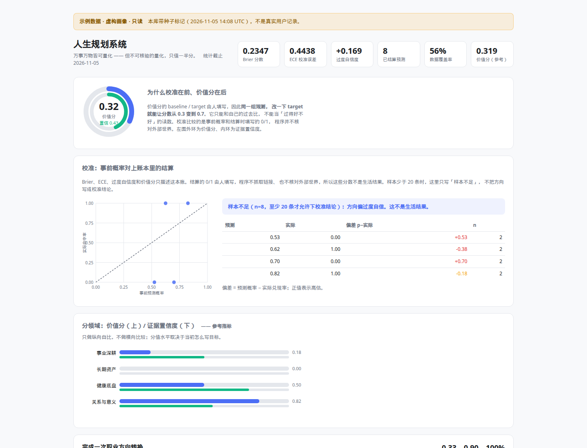

# lifeplan

<!-- problem:start -->
人生规划工具通常把目标记成待办和总分，完成次数不能说明判断准不准。
lifeplan 把目标写成可核验指标，把「我能不能做到」写成事前概率，到期用 Brier / ECE 对照账本里的结算。
示例数据是虚构画像；这些分数只描述这本账，不是生活结果，也不能拿去和别人比。
<!-- problem:end -->

<!-- honesty:test-count=203 -->
<!-- honesty:python=3.10,3.13 -->

零依赖、Python 标准库、单文件 SQLite、单文件离线 HTML 看板。数据默认留在本机。

**在线示例（虚构）：** [落地页](https://aidless.github.io/lifeplanner/) · [示例看板](https://aidless.github.io/lifeplanner/demo/dashboard.html)

## 离线路径

不装 Python、不联网也可以看数：用浏览器打开仓库里的 `landing/demo/dashboard.html`（`file://` 即可）。这个文件没有 CDN，数据是 `lifeplan/seed.py` 里的虚构画像。

在本机重算，仍然不上传：

```bash
git clone https://github.com/aidless/lifeplanner.git
cd lifeplanner
make demo
# 浏览器打开 /tmp/lifeplan-demo/dashboard.html
```

`make demo` 只写临时目录，不碰 `~/.lifeplan`。核心命令（`init` / `score` / `calibrate` / `audit` / `report` / `dashboard`）不发网络请求。解释器需要 Python 3.10+。`lifeplan setup` 读 TOML：3.11+ 用标准库 `tomllib`，3.10 需要 `tomli`；其余命令无第三方依赖。

自己的账从空库开始：`python3 -m lifeplan init`（不要加 `--seed`）。可选的 `lifeplan agent` 只有在配置了本地或远程模型端点时才会打开套接字。

## 和 aidless/life-planner 的关系

[aidless/life-planner](https://github.com/aidless/life-planner) 是另一个仓库：FastAPI + React，可选 Claude API，模块很多，用 Docker Compose 启动。本仓库不调用它、不共享数据库、不把它的页面或分数当证据。两边都叫人生规划，机制不同：这里只做本地对账。life-planner 上的数字也不是本仓库的结果。

## 读数边界

Brier、ECE、过度自信度、价值分、证据置信度都不是生活过得好不好。结算的 0/1 由人填写，程序不核对外部世界。已结算预测少于 20 条时，界面不给出「校准良好」或「系统性过度自信」这类结论。细节见 [FAILURE_MODES.md](FAILURE_MODES.md)。



---

## 为什么不是一个普通的目标追踪器

大多数「人生规划工具」做的是三件事：记 Todo、画进度条、算一个总分。
这三个做法各自有一个致命缺陷，本项目逐条修掉：

| 通行做法 | 问题 | 本项目的处理 |
|---|---|---|
| 一个总分/等级 | 标量一旦成为目标，就会被优化而非被生活充实（Goodhart 定律） | 输出**二维坐标**：价值分 × 证据置信度，不压成单一数字 |
| 记了就算数 | 「我今天健身了」和「我今天健身了，且有第三方可查记录」被同等对待 | **证据分级折减**：tier 0–3，弱证据拿不到高分 |
| 目标没达成就改基线 | 事后移动门柱，让失败看起来像成功 | **基线冻结时间**入 schema，审计模块自动检出「基线追认」 |
| 代理指标替代真实目标 | 用「复盘完成率」假装自己在提升面试能力 | 代理指标显式标记 + **代理反噬检测** |
| 「我今年一定能拿到 offer」 | 自我判断从未被验证过 | **预测台账**：事前写 p，到期结算，用 Brier/ECE 校准自己 |

---

## 三个核心机制

### 1. 价值分与证据置信度分离

```
value       = Σ wᵢ · progressᵢ / Σ wᵢ        # 方向归一化后的进展
confidence  = Σ wᵢ · confᵢ   / Σ wᵢ        # 这些进展有多少能被独立核验
composite   = value · (0.5 + 0.5 · confidence)   # 仅作参考投影，勿单独作为目标
```

证据等级与权重：

| tier | 含义 | 权重 | 例子 |
|---|---|---|---|
| 0 | 断言 | 0.10 | 只有一句「我做了」 |
| 1 | 自述 | 0.55 | 有文字描述，无法独立复核 |
| 2 | 有记录 | 0.85 | 截图、日志、文件、提交记录 |
| 3 | 可核验 | 1.00 | 公开链接、榜单、CI 结果、第三方背书 |

指标若要求 tier 3 但手上只有 tier 1，会额外触发**门槛差折减**——
「用弱证据声称完成硬指标」不会获得接近真实的分数。

### 2. 自我预测校准

把「我能不能做到」当成二分类预测任务：

```
Brier  = mean((p_hit − outcome)²)          # 越低越好
ECE    = Σ (n_b/N) · |mean_p_b − acc_b|     # 分箱校准误差
overconfidence = mean(p_hit) − mean(outcome) # 正值 = 系统性过度自信
```

可靠性曲线把预测概率分箱后与实际命中率对照，贴近对角线即校准良好。
分领域统计能定位「我在哪类事情上尤其不靠谱」。

这一套直接来自评测方法论：**裁判的可信度不来自权威，而来自其判断与实际结果的一致性。**

### 3. 自我审计

三类隐蔽的自欺，靠多打点卡解决不了，只能靠对数据本身做一致性检查：

- **基线追认**（baseline drift）：最早观测早于基线冻结时间 → 基线是事后定的
- **代理反噬**（proxy capture）：代理指标达成 ≥75% 而主指标 <40% → 代理正在替代真实目标
- **证据通胀**（evidence inflation）：同一份证据引用等级不断跃升 / 引用的文件不可达

---

## 快速开始

### 先看效果（约 3 秒）

```bash
git clone https://github.com/aidless/lifeplanner.git
cd lifeplanner
make demo        # 写入临时目录，不碰你的真实数据
# 浏览器打开 /tmp/lifeplan-demo/dashboard.html
```

也可以直接打开[在线示例看板](https://aidless.github.io/lifeplanner/demo/dashboard.html)，不安装任何东西。

### 真正开始用

```bash
cd lifeplanner

# 1. 初始化（--seed 写入虚构画像，不是任何人的记录）
python3 -m lifeplan init --seed

# 2. 看当前状态
python3 -m lifeplan score
python3 -m lifeplan calibrate

# 3. 日常使用
python3 -m lifeplan observe --metric 1 --value 12 --evidence "https://github.com/aidless/tmaudit"
python3 -m lifeplan predict --goal 1 --p 0.7 --horizon 2026-11-15 --statement "两周内拿到面试"
python3 -m lifeplan due          # 列出到期未结算的预测
python3 -m lifeplan resolve 12 --hit 0

# 4. 产出
python3 -m lifeplan report --out report.md
python3 -m lifeplan dashboard --out dashboard.html
python3 -m lifeplan audit         # 自我审计
python3 -m lifeplan export --out data.json
```

数据默认存放于 `~/.lifeplan/lifeplan.db`，可用环境变量 `LIFEPLAN_HOME` 覆盖。

---

## 数据模型

```
domains      领域（事业深耕 / 长期资产 / 健康底盘 / 关系与意义）
  └── goals 目标（带权重、起止日期）
        └── metrics 指标（方向、基线、目标、容差、采集周期、要求证据等级、
                          是否代理、基线冻结时间）
              └── observations 观测（值、日期、证据引用、证据等级）

predictions     预测台账（p_hit、到期日、结算结果）
unquantifiable  不可量化登记（名称 + 为什么不能可靠量化）
budget          时间预算（承诺 vs 产能）
events          审计事件流
```

### 指标的三种方向

| direction | 归一化 | 用途 |
|---|---|---|
| `increase` | `(v − baseline) / (target − baseline)` | 提交数、发表数、锻炼次数 |
| `decrease` | `(baseline − v) / (baseline − target)` | 竞赛分数、熬夜天数、bug 数 |
| `maintain` | 落在 `[baseline ± tolerance]` 内记 1，超出后线性衰减 | 睡眠时长、体重、每日工时 |

`maintain` 是量化系统最常缺失的一类：真正重要的往往不是「更多」，
而是「不要掉下去」。

### 不可量化登记

系统刻意保留了一个登记区。以下事项**无法被可靠量化**，把它们列出来不是缺陷，
而是系统的诚实边界——假装能测，反而会让系统给出错误的优化方向：

```bash
python3 -m lifeplan unquantifiable add \
  --name "亲密关系的质量" \
  --reason "互动次数与关系质量之间不存在稳定单调关系，高频低质互动反而可能造成负向代理偏差。"
```

种子数据里有三则虚构条目（职业长期意义感、亲密关系质量、认知能力的真实增长），用来说明登记区长什么样，不是真人案例。

---

## 输出物

### 周报（Markdown）

七个部分：总览（二维坐标）→ 分领域 → 目标明细 → 自我预测校准 →
承诺与产能 → 不可量化登记 → 自我审计。

### 看板（单文件 HTML）

零外部依赖（无 CDN、无 JS 框架），图表全部用原生 SVG 手绘。
支持浅色/深色（跟随系统偏好）。可直接进版本库、随邮件发送。

---

## 工程约定

- **纯标准库**：无第三方依赖，Python ≥ 3.10
- **单向数据流**：`db.py` 只做存取，业务逻辑在 `metrics.py` / `calibration.py` / `audit.py`
- **每个模块都可单测**：`tests/` 覆盖归一化、证据折减、校准指标、审计检测与端到端流程
- **不撒谎**：无数据的指标报「无观测」而非「表现差」；过期观测保留最后已知值并标记为过期，
  不谎报归零（对累计型指标尤其重要）

```bash
python3 -m unittest discover -s tests -v
```

---

## 设计上的已知边界

诚实地说明这套系统做不到什么：

1. **指标选错，量化越差。** 指标本身的选择错误无法被系统检测，这是最根本的失效模式。误校准和权限门禁假绿见 [FAILURE_MODES.md](FAILURE_MODES.md)。
2. **代理指标必然带偏。** 系统只能提示代理反噬，无法自动找到正确的替代指标。
3. **校准需要样本量。** n < 10 时结论只是初步信号，报告会显式标注。
4. **置信度衡量的是证据强度，不是真实度。** tier 3 也可能记录错误的内容。
5. **不替代临床判断。** 健康类指标出现异常时应寻求专业医疗意见。

---

## 与既有研究的关系

本项目把评测方法论中的几个核心工具迁移到自我管理场景：

- **证据分级 ↔ 标注质量分层**：把「断言 / 自述 / 有记录 / 可核验」显式建模
- **Brier / ECE ↔ 评测者校准**：裁判的可靠性来自判断与结果的一致性，而非权威性
- **代理指标 ↔ 评测污染**：用可测量的替代物替代真实目标时，替代物会逐渐吞噬目标
- **claim ledger ↔ 观测台账**：每条结论都要能追溯到一手记录

这也是本项目作为「LLM/Agent 评测工程师」作品集的一个侧面：
它证明的不仅是能写代码，而是**能把方法论纪律落到具体工程约束里**。

---

## 宿主感知与机器控制

系统可以自主判断「这台机器的主人在干什么」，并能够操作机器上的应用与终端。
这两件事在安全性质上完全不同，因此实现方式也分开：

| 能力 | 性质 | 策略 |
|---|---|---|
| 感知宿主（读目录 / git / 进程 / 历史） | 只读，无副作用 | 全自动，不限次 |
| 提议（把发现变成待办） | 只写自己的库 | 全自动，但不执行 |
| 操作机器（跑命令 / 启应用 / 模拟输入） | 有副作用 | 分级 + 确认 + 全量审计 |

### 五级门禁

| tier | 名称 | 例子 | 默认行为 |
|---|---|---|---|
| 0 | 观察（只读） | `ls`、`cat`、`git status`、`grep` | 自动执行并记账 |
| 1 | 工作区写入 | `mkdir`、`touch`、`cp`（限 jail 内） | 自动执行并记账 |
| 2 | 执行 | `curl`、启动应用、跑脚本、`git commit` | **需回填一次性令牌** |
| 3 | 破坏性 | `rm`、`mv`、`sed -i`、`find -delete`、装包、kill | **默认拒绝**；改策略后仍需确认 |
| 4 | 禁止 | `sudo`、`mkfs`、`dd`、`systemctl`、`bash -c`、`rm /` | 永不放行 |

令牌绑定 `动作ID + 命令原文 + 当天日期`，因此：命令被改动 → 失效；隔天 → 失效；
提案执行过一次 → 拒绝重放。

### 命令

```bash
# 感知：扫描并推断「宿主在干什么」（每条结论都带证据）
lifeplan host scan                 # 默认扫家目录
lifeplan host scan --include-history   # 纳入 shell 历史（敏感行自动打码）
lifeplan host show                 # 看最近一次画像
lifeplan host caps                 # 本机实际可用的控制能力

# 自主循环：感知 → 提议 → 等你确认
lifeplan act tick                  # 只提议，不执行
lifeplan act list                  # 看待处理提议
lifeplan act run 12 --confirm-token <token>

# 终端（全部经门禁）
lifeplan term run -- ls -la
lifeplan term run -- git status
lifeplan term run -- rm notes.txt  # 默认被拒
lifeplan term log                  # 执行记录

# 应用
lifeplan apps list --filter chrome
lifeplan apps launch "Google Chrome"   # tier2，需确认
lifeplan apps windows
lifeplan apps type "hello" / apps key ctrl+s / apps focus <id>

# 策略
lifeplan policy                    # 查看当前策略与分级含义
```

### 某台 Ubuntu 24.04 / Wayland 机器上的一次观察

下面不是 CI 结果，也不是每台机器的能力。`lifeplan host caps` 会按当前机器重新探测。2026-10 在一台没有 `xdotool` / `wmctrl` 的机器上看到：

```
✓ 启动应用      ✓ 枚举应用
✗ 枚举窗口      ✗ 聚焦窗口      ✗ 模拟输入      ✗ 发送按键      ✗ 截屏
```

要补窗口控制，需要自己安装：

```bash
sudo apt install xdotool wmctrl
# Wayland 原生窗口还需 ydotool（XWayland 窗口 xdotool 可直接用）
```

系统不会自己装系统包——那属于改动系统状态，应当由你决定。

### 边界声明（重要）

1. **这不是沙箱。** 它约束的是「经由本系统发起的动作」，不能阻止你在别处做任何事，
   也不能阻止已运行的进程自己提权。
2. **黑名单不是安全边界。** 任何解释器都是万能逃逸口（`python -c` / `node -e` 能做任何事），
   所以真正的边界是「分级 + 确认 + 审计」这三条，而不是命令过滤表。
   正因如此，解释器内联代码默认归入禁止级。
   只检查工作目录、或把策略文件里的 `"false"` 字符串当成布尔，都会假绿。见 [FAILURE_MODES.md](FAILURE_MODES.md)。
3. **不防提示注入。** 如果你让模型去读一个不可信的文件/网页，并据此让它执行命令，
   模型可能被诱导。对策是架构性的：**提案与执行分离**，任何副作用都要你亲手确认。
4. **不做隐蔽操作。** 每个动作执行前就写入 `actions` 表，事后可查、可复盘；
   不存在「静默执行」的代码路径。
5. **感知只在本机。** 不发网络请求、不上传、不读取浏览器数据或密码库；
   shell 历史中的敏感行会整行打码且不参与统计。

### 修改策略

策略是纯文本 JSON，位于 `~/.lifeplan/policy.json`：

```json
{
  "allow_observe": true,
  "allow_workspace_write": true,
  "allow_execute": false,        // 改成 true 则 tier2 免确认（不推荐）
  "allow_destructive": false,    // 改成 true 才可能执行 tier3，且仍需确认
  "allow_shell_wrapper": false,  // 改成 true 才允许 bash -c / python -c
  "workspace_jail": ["~"],
  "timeout_seconds": 30,
  "max_output_chars": 20000
}
```

改完用 `lifeplan policy` 复查。

---

## 专属 Agent：Jev

`lifeplan agent` 是一个垂直 agent，只服务于「人生规划系统」这一个领域：

- 事实**只能**来自工具返回，不允许自由发挥
- 答复里的每个数字都要能追溯到某次工具调用，否则被标红
- 涉及执行/启动应用时，它只能生成**待确认提案**，永远无法自己动手

### 三种驱动，按优先级自动选择

| 适配器 | 说明 | 当前状态 |
|---|---|---|
| `jev-local` | 加载本地 Jev 检查点。**必须先通过健康检查**（探针损失 ≤ 3.5），否则拒绝使用 | ✗ 无检查点（已封存） |
| `openai-compat` | OpenAI 兼容端点。未配置时探测本机 Ollama，按偏好选模型（3B 优先） | 探测成功才可用；CI 不假设本机有 Ollama |
| `scripted` | 确定性关键词路由，永远可用，不做推理 | ✓ 兜底 |

2026-10 在一台没有 GPU 的机器上，自动发现选过 `llama3.2:3b`（约 1–9 秒）并让 `qwen3:8b` 在 CPU 上超时。那是一次本地笔记，CI 不复跑，数字会过时。适配器只在端点真的列出该模型时才选用，不在就报错。

用 `LIFEPLAN_LLM_MODEL` / `LIFEPLAN_LLM_BASE_URL` 覆盖即可。

`lifeplan agent doctor` 会如实告诉你当前用哪个、其余为什么不可用。

**为什么要有兜底**：只能靠模型驱动的 agent，模型不可用时完全不可用；只能靠规则的 agent 又长不出推理能力。所以做成可替换适配器，并把「当前用的是什么」暴露出来，而不是假装模型在工作。

### 工具（12 个，按权限分级）

| 工具 | tier | 作用 |
|---|---|---|
| `plan_score` / `plan_goals` | 0 | 整体状态、目标与指标清单 |
| `plan_calibration` | 0 | Brier / ECE / 过度自信度 |
| `plan_audit` | 0 | 基线追认、代理反噬、证据通胀 |
| `host_profile` | 0 | 宿主画像（含证据链） |
| `predictions_due` / `proposals_list` | 0 | 待结算预测、待处理提议 |
| `log_observation` | 1 | 记录观测（需 `--write`） |
| `register_prediction` / `resolve_prediction` | 1 | 预测登记与结算（需 `--write`） |
| `term_exec` | 2 | **只生成提案**，不执行 |
| `app_launch` | 2 | **只生成提案**，不执行 |

### 三条硬约束（由代码保证，不靠提示词自觉）

1. **tier2 不执行**：`term_exec` / `app_launch` 只写一条 `proposed` 记录并返回令牌。
   测试里断言过：调用后 `actions` 表中 `status='done'` 的行数必须为 0。
2. **数字要能追溯**：`verify.unsupported_numbers` 逐字比对答复与工具结果，
   允许四舍五入与百分数换算，其余一律判为无依据。
3. **无工具结果不给数字**：空口作答直接标记为无依据。

### 用法

```bash
lifeplan agent doctor                 # 看当前驱动与可用性
lifeplan agent tools                  # 看工具清单与参数
lifeplan agent ask 现在状态怎么样
lifeplan agent ask 我对自己判断准不准 --verbose
lifeplan agent ask 这台机器是干什么的
lifeplan agent ask 有没有自欺
lifeplan agent ask 我下一步该做什么
lifeplan agent ask 记录 metric#1 等于 12 --write    # 允许 tier1 写入

# 涉及执行时，agent 只给提案，人来确认：
lifeplan act run <id> --confirm-token <token>
```

完整对话样例见 `examples/agent_demo.md`。

### 交付一个能真的驱动它的模型

`jev-local` 就绪需要两步（见 `../jev1b/README.md`）：

```bash
# 1. 训练（当前机器无 GPU，需在有卡环境或用蒸馏路线）
cd ../jev1b
python3 -m jev.train --config jev-1b --steps ... --out runs/jev-1b

# 2. 放到约定路径，agent 会自动启用并做健康检查
mkdir -p ~/.lifeplan/models
cp ../jev1b/runs/jev-1b/ckpt.pt ~/.lifeplan/models/jev-1b.pt
lifeplan agent doctor      # 应显示 ✓ jev-local（探针损失 x.xx）
```

或者接一个现成模型（更适合当前阶段）：

```bash
export LIFEPLAN_LLM_BASE_URL=http://127.0.0.1:11434/v1   # Ollama
export LIFEPLAN_LLM_MODEL=qwen3:8b
lifeplan agent ask 我对自己判断准不准
```

仓库不绑定某一台机器上的模型。没有端点时走 `scripted` 兜底。种子库上的校准问答见 `examples/agent_demo.md`：n=8 时结论文案是「样本不足」，不是「系统性过度自信」。模型可以写得很空，数字必须出现在答复里，且每个都要能追溯到工具调用。

## 自动化

仓库里没有安装 cron 或 systemd 定时器。下面是一条建议的周一清单，需要你自己挂到调度器上；本仓库不会代为安装。

1. `lifeplan doctor`（未初始化则 `lifeplan init`，**不带 --seed**）
2. `lifeplan week --plan-only` + `lifeplan act tick`
3. `lifeplan agent ask 有没有自欺`
4. 汇总清单条数、待确认提议、校准状态

它只适合**提醒与汇报**。代填数据和确认提案这两步留在人手里。

---

## 每周复盘（推荐入口）

交互从「逐条指标」改成「一周一次」，记录在 2026-10-22 的设计笔记里（`docs/OPTIMIZATION.md`）：当时那份自用库的观测全部来自种子。那是一次设计笔记，不是用户研究，也不是生活结果。按种子周期粗算，逐条记录大约一周十几次打断。

所以把交互单位从「指标」改成「周」：

```bash
lifeplan week              # 一次跑完：结算到期预测 + 补录过期指标 + 可选归档
lifeplan week --plan-only  # 只列清单
lifeplan week --dry-run    # 演练，不写库
lifeplan week --limit 6    # 只处理 6 项（默认 12）
```

一次最多 12 项、3 分钟内结束。每条都可跳过——**强制补数据会让人整个放弃**。

可自动推断的指标会给建议值（例如「月度有效提交数」由近 7 天 git 提交数推算），
回车即接受。推不出来的（睡眠、面试、关系）不做假推断：那会污染台账，比没有数据更糟。

跑完会回读一次校准。输出里有结算条数和当前结论文案。样本不足时，这行是「样本不足」，不是对人的判断。仓库不保留某一次真实复盘的数字。

归档是降级而不是删除：指标不再参与评分与提醒，数据保留，随时可恢复。

## 备份与恢复

数据库是单文件（`~/.lifeplan/lifeplan.db`），丢了就是全部。

```bash
lifeplan backup --out ~/lifeplan-backup.db     # 在线备份 + 立即校验行数
lifeplan restore --from ~/lifeplan-backup.db --force
```

`restore` 的行为：先校验备份文件表结构完整 → 自动把当前库另存为
`.pre-restore-<时间戳>.db` → 再覆盖。不带 `--force` 会直接拒绝。
仓库里没有一份可复现的「恢复后多少条观测」基准文件；行为以 `tests/` 为准。

## 优化诊断

`docs/OPTIMIZATION.md` 记录了对这个项目的体检结论：
5,711 行代码 / 21 个子命令 / 真实观测 0 条 / 无 git / 无备份，
以及为什么下一步应该**降低输入次数**而不是继续加功能。

---

## 工程化

```bash
make test        # 条数见文首 honesty:test-count，由 tests/test_honesty.py 核对
make check       # 语法检查 + 死代码扫描
make demo        # 临时目录跑完整流程
make report      # 生成 examples/report.md
make dashboard   # 生成 examples/dashboard.html
make site        # 构建落地页 + 示例看板到 dist/
make backup      # 备份数据库
make doctor      # 系统体检
```

`lifeplan doctor` 一次摊开所有健康信息：库路径与 schema 版本、各表行数、
观测来源（并区分是否含种子数据）、校准状态、权限策略、桌面控制能力、
最后备份时间、agent 当前驱动。

```
数据库　~/.lifeplan/lifeplan.db
  schema 版本与代码一致时标 ✓，否则标需迁移
观测来源会分开计数
  ⚠ 若本库含种子数据，计数包含演示记录，不是真实使用量
```

CI 在 `.github/workflows/ci.yml`：纯标准库，无需 pip install。
Python 版本见文首 `honesty:python`（当前 3.10 与 3.13），跑测试和端到端冒烟。
Pages 构建使用其中的一个版本。另有一份 workflow 会让矩阵分叉，所以仓库里不再放第二份测试 workflow。

## 报告结构（2026-10-22 调整）

**校准在前，价值分在后。**

```
一、校准摘要（主指标）   Brier / ECE / 过度自信 / 可靠性分箱 / 分领域偏差
二、计划状态（参考）     明确标注「自造标量，不可当过得好不好的读数」
三、分领域   四、目标明细   五、承诺与产能
六、不可量化登记   七、自我审计   附、宿主画像
```

价值分的 baseline / target 由人填写，同一组观测改一下 target，分数就会跳，所以它只能自比。
校准比较事前概率和账本里的 0/1，所以排在前面。它仍然不是生活结果。
虚构种子的分箱在示例看板里（每格 n=2）。样本不够时，这些格子不能读成对一个人的结论。
设计笔记见 `docs/OPTIMIZATION.md` §7.2，假绿见 `FAILURE_MODES.md`。

---

## Q-One：万物量化协议

把「万事万物皆可量化」落成**可复算的测量协议**，而不是随意打分：

> 对任何对象，先定义可观测变量、单位或尺度、参考系和证据，
> 再给出数值、区间、置信度、未知项和下一步测量。

```bash
lifeplan qone ask "这个项目是否值得继续投入？"     # 完整量化决策
lifeplan qone ask "..." --json                     # 机器可读契约
lifeplan qone list                                 # 决策台账
lifeplan qone verify                               # 台账哈希校验
```

### 六层架构

| 层 | 实现 | 职责 |
|---|---|---|
| 量化编译器 | `qone.qcompile()` | 问题 → 测量计划（v1 垂直域规则，v2 上 LLM） |
| 证据 Agent | `qone._evidence()` | git / 数据库 / 文件，每项带 sha256 |
| 计算引擎 | `calc.py` | **所有数值在此产生，模型永不碰算术** |
| 决策模型 | `_decide()` | Laya/Jev 风格 choice/noul，不可用则文档化规则 |
| 不确定性层 | `_uncertainty()` | 自助法区间、置信度、**拒答策略** |
| 溯源账本 | `ledger.py` | 每次决策完整留痕 + 哈希可验伪 |

### 输出契约

```json
{
  "投入强度": {"value": 731, "interval": null, "unit": "commits_per_30d"},
  "价值总评": {"value": 55.0, "interval": [5.0, 100.0], "unit": "score_0_100"},
  "risk": {"level": "高", "rule": "价值总评<35→极高；35-60→高；…"},
  "action": "collect_more_evidence",
  "confidence": {"model": 0.8, "evidence": 0.75, "forecast": null},
  "confidence_type": "heuristic",
  "evidence_sufficiency": "insufficient",
  "evidence": [{"kind": "git", "detail": "...", "value": 731, "sha256": "..."}],
  "assumptions": ["投入强度以 git 提交为代理，不等于价值创造"],
  "unknowns": ["校准样本不足（n=0），自评准确度只能当方向参考"],
  "next_measurement": "…",
  "decided_by": "abstain"
}
```

### 三条设计红线（均有测试）

1. **模型不碰算术**：表达式求值走 AST 白名单，没有 `eval`、没有属性访问
   （`tests/test_qone.py::TestCalcSafety`，`__import__`/`os.system`/`lambda` 全部拒绝）
2. **没有证据就不裁决**：无可核验观测、无校准样本、无指标目标时，
   只允许 `need_data`——实测教训：空库上 731 次 git 提交曾把价值分撑到 55、
   裁决 `pivot`，**活动量冒充了证据**
3. **台账可验伪**：sha256 覆盖规范化 JSON，改一个字节就能被发现
   （`lifeplan qone verify`）

### 仓库结构（文档 §15）

```
charter/     总纲 · 量化原则 · 研究问题 · 术语 · 非目标 · 隐私
literature/  论文矩阵 · 综述 · claim 台账 · 能力地图 · BibTeX
ontology/    人生本体(15域) · 指标词典 · 测量契约 Schema · 证据 Schema
agent/       架构 · 协议 · 模型路由 · 行动权限 · 决策 Schema
benchmarks/  评测规范 · baseline_results/ · calibration/ · ablations/ · failure_cases/
model/       训练计划 · 数据卡 · checkpoints/（阶段八）
life-system/ 失败日志 · 试点 · 人生系统v1 · 日常/周/月复盘 · 决策日志规范
reports/     研究报告 · 评测报告 · 失败分析 · 后续工作
```

### 当前 Scope（诚实版）

v1 只覆盖**项目投入决策**一个垂直域，其余问题显式拒绝并记入 unknown——
诚实的 Scope 好过虚假的通用。v2 路线：LLM 编译器拆解 → 积累决策数据 →
训练自己的 Q-One 决策模型（choice/score/noul → measure/forecast/rank）→
评测体系（数值误差、Brier、ECE、拒答质量、证据完整性、可复现性）。

---

## 项目总纲：从人生规划系统到「人生系统」

本仓库正按十阶段路线演进为**可审计的人生操作系统**（总纲见 `charter/PROJECT_CHARTER.md`）：

```
开源模型论文研究 → 能力组件归纳 → 量化本体设计 → Agent 原型
→ 个性化决策模型 → 可审计的人生操作系统
```

### 已交付的文档资产

勾表示仓库里有这份文件，不表示研究问题已经被数据回答，也不表示有人用这套账生活过。

| 文件 | 内容 | 阶段 |
|---|---|---|
| `charter/PROJECT_CHARTER.md` | 总纲：核心命题、五条禁止事项、角色边界、十阶段路线 | 一 ✅ |
| `charter/QUANTIFICATION_PRINCIPLES.md` | 万物量化十原则（量化八元组、证据分级、拒答策略…） | 一 ✅ |
| `charter/RESEARCH_QUESTIONS.md` | 10 个研究问题，各带可证伪判据 | 一 ✅ |
| `charter/GLOSSARY.md` | 全文术语统一 | 一 ✅ |
| `literature/literature_matrix.csv` | 40 篇代表论文/模型矩阵（9 家族） | 二 🔄 |
| `literature/claim_ledger.md` | 已核验声明台账（含 4 条本项日实测声明 + 5 条待核） | 二 🔄 |
| `literature/model_capability_map.md` | 10 个能力组件：选型/可本地/评测/降级 | 三 🔄 |
| `ontology/life_ontology.yaml` | 11 域本体：12 个指标九字段定义 + 跨域审计规则 | 四 🔄 |
| `ontology/metric_dictionary.md` | 指标词典与设计说明（如「学习质量」五维分解） | 四 🔄 |
| `charter/NON_GOALS.md` · `charter/privacy_policy.md` | 非目标清单 · 隐私政策 | 一 ✅ |
| `literature/literature_review.md` · `literature/references.bib` | 综述（40 篇）+ BibTeX | 二 🔄 |
| `agent/ARCHITECTURE.md` · `agent/AGENT_PROTOCOL.md` · `agent/MODEL_ROUTING_GUIDE.md` | 架构/协议/路由 | 四 ✅ |
| `agent/*.schema.json`（3 份） | 测量/证据/决策协议 Schema（有测试校验） | 四 ✅ |
| `benchmarks/benchmark_spec.md` | 七级基线 + 消融 + 指标 | 七 ⬜ |
| `life-system/FAILURE_LOG.md` · `life-system/PILOT_CASES.md` | 10 次失败记录 · 试点案例 | 五 🔄 |
| `docs/OPTIMIZATION.md` · `docs/REVIEW-2026-10-22.md` | 优化诊断与复视记录 | —— |

### 核心路线（不可颠倒）

> **先定义，再量化；先证据，再决策；先做 Agent，再训练模型；先服务人生，再追求通用性。**

### 两条设计红线

1. **不建立代表「人生好坏」的单一总分**（多维并列 + 置信度标注）
2. **模型不绕过人的最终决定权**（tier≥2 行动必须人工确认令牌）
