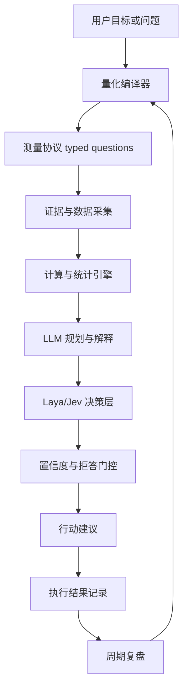

# ARCHITECTURE.md · Q-One 系统架构

> 对应文档 §7。**信任只沿箭头传递，没有箭头的地方没有信任。**

版本：v1（2026-10-22）

---

## 1. 总流程



## 2. 各层职责与实现

| 层 | 实现 | 输入 | 输出 | 硬约束 |
|---|---|---|---|---|
| 量化编译器 | `qone.qcompile()` | 自然语言 | 测量计划 | v1 规则版；域外拒答 |
| 证据层 | `qone._evidence()` + `presence.py` | 测量计划 | 证据（sha256） | 每项带哈希；推不出就不猜 |
| 计算层 | `calc.py` + SQL | 证据 | 数值/区间 | AST 白名单；模型不碰算术 |
| LLM 层 | `agent/adapters.py::OpenAICompat` | 问题+证据 | 候选解释/拆解 | v2 主力；输出必须结构化 |
| 决策层 | `SystemOneAdapter` + 规则 | state+typed questions | choice/score/noul | 置信 <0.6 升级 |
| 门控层 | `qone._uncertainty` + 拒答 | 数值+裁决 | 建议 / need_data | 无证据只准拒答 |
| 行动层 | `policy.py` + `terminal.py` | 建议 | 提案/执行 | tier≥2 必须人确认令牌 |
| 复盘层 | `week.py` + `audit.py` + `calibration.py` | 台账 | 修正 | 四查 + 周复盘 |

## 3. 信任边界（本架构的核心）

```
LLM  ──✗──→  数值        （模型输出数字一律不信）
LLM  ──✗──→  执行        （模型不能执行 tier≥2）
决策层 ──✗──→ 无证据裁决  （拒答策略优先于模型）
计算层 ──✗──→ 意义解释    （统计不说"这很好"）
```

允许的传递：
```
LLM → 候选指标/假设/拆解（人批准后进协议）
证据 → 计算 → 数值+区间（唯一数值来源）
数值+证据 → 决策层（typed questions）
决策+置信度+证据覆盖 → 建议（人确认后行动）
```

## 4. 数据模型（本体实体）

```
Person ─< Domain ─< Goal ─< Metric ─< Observation
                        └─< Prediction ── Outcome
Decision ── Action ── Outcome
Review ── 修正 Goal/Metric/权重
```

实现：SQLite 11 表 + `decisions` 台账（`ledger.py`）。

## 5. 模型路由（详见 MODEL_ROUTING_GUIDE.md）

| 任务 | 首选 | 降级 |
|---|---|---|
| 拆解/解释 | 本地 3-8B LLM | scripted 规则 |
| 零参数工具路由 | Laya（33ms） | scripted |
| 带参工具调用 | LLM | scripted（不猜参数） |
| 数值/区间 | 计算引擎 | unknown |
| 校准/ECE | 统计 | —— |

## 6. 失败模式与对应防线

| 失败 | 防线 |
|---|---|
| 模型编数字 | 数据附录 + verify.py 数字溯源 |
| 模型空泛作答 | 数据附录强制在场 |
| 模型跳过工具直答 | 无观测答复标记「无数据支撑」 |
| 证据缺失硬答 | 拒答策略 |
| 高危误执行 | tier 门禁 + 令牌 + 全量审计 |
| 台账被改 | sha256 + `qone verify` |
| 库损坏 | backup/restore 演练 |

## 7. 部署形态

- 单机单文件（SQLite），无服务、无账号、无网络依赖（模型调用可选本机 Ollama）
- 周一自动化：doctor → week 清单 → act tick → 校准汇报（只提醒不代劳）
